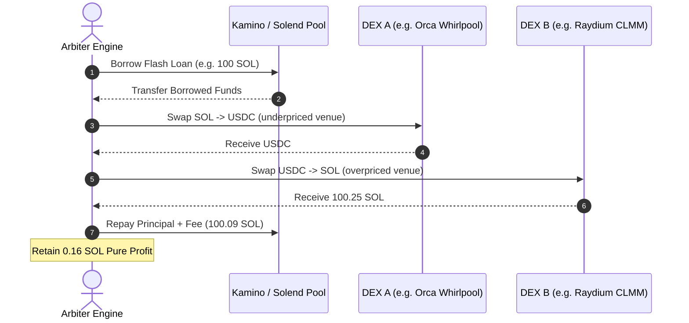

# Solana Flash Loan Arbiter

[](https://solana.com)
[](https://www.typescriptlang.org/)
[](https://opensource.org/licenses/Apache-2.0)

Sub-second atomic flash loan arbitrage and liquidation routing executor on Solana utilizing Solend, Kamino, and Marginfi lending pools.

Enables zero-capital atomic cross-DEX price discrepancy exploitation, priority compute unit optimization, and instant loan repayment within a single atomic Solana transaction.

---

## 🌟 Key Features

- **Zero-Capital Atomic Flash Loans**: Borrows liquidity from Kamino / Solend lending reserves and executes multi-hop arbitrage routes, reverting atomically if net profit conditions are not met.
- **Dynamic Fee & Gas Deduplication**: Accurately computes exact protocol borrow fees, DEX taker fees, and priority compute unit costs before transaction broadcast.
- **Liquidation Monitoring**: Identifies undercollateralized lending obligations across money markets to route instant liquidation bonus payoffs.
- **Sub-Second Execution**: Streamlined transaction building with Versioned Transactions (v0) and custom lookup table integration.



---

## 📂 Project Structure

```text
solana-flash-loan-arbiter/
├── examples/
│   └── execute-arb.ts          # Simulation runner demonstrating profitability checks
├── src/
│   ├── types.ts                # TypeScript interfaces for pools, loans, and hops
│   ├── flash-loan-engine.ts    # Fee calculation and atomic transaction composer
│   ├── liquidation-router.ts   # Collateral health factor evaluator
│   └── index.ts                # Public exports
├── package.json                # Project dependencies
├── tsconfig.json               # TypeScript configuration
└── README.md
```

---

## 🚀 Quick Start

### Installation

```bash
git clone https://github.com/unfitpolyp/solana-flash-loan-arbiter.git
cd solana-flash-loan-arbiter
npm install
```

### Build

```bash
npm run build
```

### Run Arbitrage Simulation

```bash
npx ts-node examples/execute-arb.ts
```

---

## 📄 License

Licensed under the [Apache License, Version 2.0](LICENSE).
